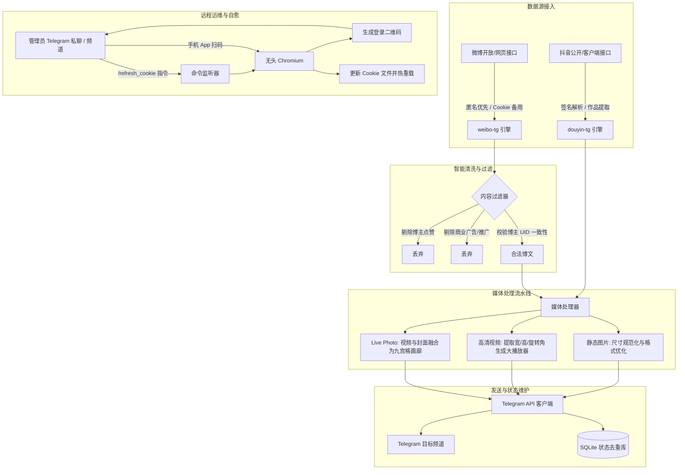

<div align="center">

# 📡 Weibo & Douyin to Telegram Forwarder

**高可用、高保真、智能化社交媒体动态转播机器人**

自动监控指定**微博博主**与**抖音作者**的最新动态，将高清图片、**Live Photo 实况动图**及**高清视频**以原生流媒体形态毫秒级推送到 Telegram 频道。

[](https://www.python.org/)
[](https://www.docker.com/)
[](https://weibo.com)
[](https://core.telegram.org/bots/api)
[](https://github.com)
[](LICENSE)

</div>

---

## 💡 为什么选择本项目？

普通抓取转发工具通常面临三大痛点：**媒体体验差**（Live Photo 沦为散落短视频、视频播放出现黑边变形）、**内容噪音大**（大量博主点赞、商业推广充斥频道）、**维护成本高**（Cookie 过期频繁需要登录服务器重新抓包）。

本项目针对 Telegram 客户端规范进行了深度工程定制：
1. **全原生媒体体验**：Live Photo 与常规照片无缝融合为九宫格画廊；长视频自适应原生大窗无黑边播放。
2. **零噪音内容过滤**：内置点赞过滤与推广拦截算法，严格确保频道仅包含博主本人的原创与真实转发。
3. **无感运维与自愈**：通过 Telegram 指令即可触发无头浏览器生成扫码二维码，手机扫码即可刷新 Cookie，免去任何服务器抓包操作。

---

## 🏗️ 系统架构



---

## 🌟 核心特性详解

### 1. 📸 实况动图（Live Photo）原生九宫格融合
- **画廊级浏览**：将 Live Photo 拆解出的动态微视频与高清静态图打包为统一的 Telegram `sendMediaGroup` 媒体组。
- **点开即动**：在手机或电脑端点开画廊即可自动循环播放动效，告别相册底部刷屏散落大量短视频片段的混乱排版。
- **混排兼容**：单条微博内无论是纯静态图、纯实况图，还是静态图与实况图混排，均可精确组装为标准 9 宫格。

### 2. 🎬 高清视频原生大播放器自适应
- **元数据精准探测**：通过多媒体分析工具精准提取视频真实宽度、高度、旋转角度（`rotation`）与精准时长。
- **拒绝畸形黑边**：配合合规的轻量化高清缩略图上传，使 Telegram 客户端无论在 iOS、Android 还是 Desktop 上均能呼出原生大视窗播放器，画面铺满无黑边。

### 3. 🎯 深度内容清洗与精准过滤
- **自动剔除博主点赞**：彻底过滤微博信息流中插入的“博主赞过的微博”聚合卡片，绝不误推博主点赞的内容。
- **广告与营销拦截**：精准识别并剔除商业广告推广流、粉丝头条、营销号卡片等非本人发布的内容。
- **严格身份二次校验**：抓取后再次对比微博与抖音作者的原始 ID，确保仅有博主本人的原创动态与显式转发进入推送流水线。

### 4. 🛡️ 智能抗风控双轨抓取
- **匿名优先策略**：默认优先采用免登录匿名接口快速轮询，不消耗主账号权限，降低风控封锁风险。
- **无缝降级兜底**：遇到风控限制、IP 冷却或博主设置“仅粉丝可见”时，系统毫秒级自动切换至 Cookie 登录态备用链路。
- **随机轮询抖动（Jitter）**：每次轮询间隔均叠加可配置的随机浮动时间，消除机械化周期请求指纹。

### 5. 📲 Telegram 交互式无感扫码续期
- **主动远程指令**：在 Telegram 中随时向 Bot 发送 `/refresh_cookie`，服务自动调起无头 Chromium 浏览器生成最新登录二维码并回传。
- **被动失效告警**：连续多轮检测到接口失效时，自动触发梯级告警并主动推送扫码求助。
- **容器沙箱自愈**：专门针对 Docker root 容器环境适配了 Chromium 沙箱兼容机制，确保在各种 Linux 服务器下稳定唤起浏览器，无需手动抓包复制。
- **零凭证存储**：不记录或上传任何账号密码，仅在手机扫码后本地保存官方下发的通行凭据。

### 6. ⚡ 微博 + 抖音双引擎独立隔离
- **单仓双核独立进程**：`weibo-tg` 与 `douyin-tg` 互相独立运行，共享同一套配置体系与 Telegram 机器人。
- **容灾解耦**：微博与抖音各自拥有独立的 SQLite 数据库（`state.sqlite3` 与 `douyin-state.sqlite3`）与媒体缓存目录，单方网络抖动或异常绝不影响另一方。

### 7. 🧹 生产级可靠性设计
- **首次启动防刷屏（Seed 模式）**：初次配置新账号接入时，系统仅对历史博文建立索引基准，只转发启动后最新发布的动态，避免数千条历史博文同时轰炸频道。
- **临时文件即刻销毁**：媒体文件发送成功后立即从本地磁盘抹除（可配置开关），保障长期无人值守运行下磁盘空间零泄露。

---

## 🚀 快速上手部署

### 方式一：Docker Compose 一键部署（生产推荐）

#### 1. 克隆代码与准备配置

```bash
git clone https://github.com/your_username/weibo-tg-forwarder.git
cd weibo-tg-forwarder

# 复制环境变量与配置文件
cp .env.example .env
cp config.example.yml config.yml
```

#### 2. 编辑配置文件

**编辑 `.env`：**

```dotenv
# Telegram 机器人 Token（向 @BotFather 申请获得）
TELEGRAM_BOT_TOKEN=1234567890:ABCdefGHIjklMNOpqrSTUvwxYZ

# 转发的目标频道（公开频道填写 @channel_username，私有频道填写 -100 开头的数字 ID）
TELEGRAM_CHANNEL_ID=@my_media_channel

# 管理员与 Bot 私聊的用户数字 ID（用于接收告警和授权 /refresh_cookie 扫码指令）
TELEGRAM_ALERT_CHAT_ID=123456789

# 初始微博 Cookie（选填，留空则默认纯匿名抓取；后续可用扫码直接录入）
WEIBO_COOKIE=

# 初始抖音 Cookie（选填，留空则默认纯匿名抓取）
DOUYIN_COOKIE=
```

**编辑 `config.yml` 添加目标博主：**

```yaml
weibo:
  targets:
    - uid: "1000000001"    # 微博博主数字 UID 示例
    - uid: "1000000002"
  poll_interval_seconds: 120
  poll_jitter_seconds: 60

douyin:
  targets:
    - uid: "example_user"  # 抖音号
      sec_uid: "MS4wLjABAAAA..." # 对应的 sec_uid（可通过 douyin-tg resolve 自动解析）
  poll_interval_seconds: 180
  poll_jitter_seconds: 60

telegram:
  notifications_use_channel: true  # 告警和二维码是否直接发到频道（方便直接扫码）

storage:
  keep_media_after_send: false     # 发送成功后自动删除本地下载的临时文件
```

#### 3. 启动后台容器

```bash
# 构建镜像并启动所有容器
docker compose up -d --build

# 查看服务运行状态
docker compose ps

# 查看微博监控实时日志
docker compose logs -f weibo-tg

# 查看抖音监控实时日志
docker compose logs -f douyin-tg
```

---

### 方式二：本地开发与 CLI 手动运行

适用于在 macOS 或 Linux 桌面环境进行调试与开发：

```bash
# 1. 创建虚拟环境并安装完整依赖
python3 -m venv .venv
source .venv/bin/activate
pip install -e '.[dev,douyin]'

# 2. 安装无头浏览器运行环境（用于扫码续期）
playwright install chromium

# 3. 运行全链路自检诊断
weibo-tg --config config.yml doctor
douyin-tg --config config.yml doctor

# 4. 预览抓取（仅获取元数据与日志，不实际发送 Telegram）
weibo-tg --config config.yml preview --limit 1

# 5. 启动本地前台监控
weibo-tg --config config.yml run
```

---

## ⚙️ 完整配置项详细说明

下表列出 `config.yml` 的全部支持配置参数及其功能：

| 配置节点 | 参数名 | 类型 | 默认值 | 作用说明 |
| :--- | :--- | :--- | :--- | :--- |
| **weibo** | `targets` | 列表 | - | 需要监控的微博博主列表，每个条目包含 `uid` |
| | `poll_interval_seconds` | 整数 | `120` | 轮询基础休眠间隔（秒） |
| | `poll_jitter_seconds` | 整数 | `60` | 随机浮动延迟上限（秒），实际间隔为 interval ± jitter |
| | `anonymous_retry_seconds`| 整数 | `86400` | 匿名接口封锁后的冷却恢复等待时间（秒） |
| | `max_pages` | 整数 | `5` | 单次抓取最大回溯页数 |
| | `request_timeout_seconds`| 整数 | `25` | 微博网络请求超时阈值（秒） |
| **douyin** | `targets` | 列表 | - | 需要监控的抖音作者列表，包含 `uid` 与 `sec_uid` |
| | `poll_interval_seconds` | 整数 | `120` | 抖音轮询基础休眠间隔（秒） |
| | `poll_jitter_seconds` | 整数 | `60` | 抖音轮询随机浮动延迟（秒） |
| | `max_pages` | 整数 | `2` | 单次抓取最大翻页数 |
| **telegram** | `api_base` | 字符串 | `https://api.telegram.org` | Telegram Bot API 网关地址（支持自建反向代理） |
| | `request_timeout_seconds`| 整数 | `90` | 上传大视频与媒体组时的 HTTP 超时时间（秒） |
| | `notifications_use_channel` | 布尔 | `true` | 是否将维护告警与登录二维码同步推送到转发频道 |
| **storage** | `database` | 路径 | `./data/state.sqlite3` | 微博博文去重与发送记录数据库路径 |
| | `douyin_database` | 路径 | `./data/douyin-state.sqlite3`| 抖音作品去重与发送记录数据库路径 |
| | `media_directory` | 路径 | `./data/media` | 临时媒体下载与转码暂存目录 |
| | `cookie_file` | 路径 | `./data/weibo_cookie.txt` | 扫码自动更新的微博 Cookie 本地存储路径 |
| | `keep_media_after_send` | 布尔 | `false` | 发送完成后是否保留本地媒体文件（建议设为 false） |
| | `max_download_megabytes` | 整数 | `2000` | 媒体单次最大下载配额保护限制（MB） |
| **service** | `bootstrap_mode` | 字符串 | `seed` | 首次运行策略：`seed` 仅记录当前博文作为基准；`fetch` 会立刻补发最新博文 |
| | `alert_after_consecutive_failures` | 整数 | `3` | 连续抓取失败达到设定次数后向 Telegram 发送报警 |
| | `cookie_refresh_enabled` | 布尔 | `true` | 是否开启基于无头浏览器的自动扫码刷新功能 |

---

## 🧰 CLI 常用运维命令清单

容器内或本地虚拟环境中均集成了功能完整的维护工具：

### 微博管理工具 (`weibo-tg`)

```bash
# 1. 全链路健康检查（检查配置、Cookie、网络、数据库及 Bot 连通性）
weibo-tg doctor

# 2. 查看当前与 Bot 发起过私聊对话的用户 ID（便于填写 TELEGRAM_ALERT_CHAT_ID）
weibo-tg telegram-chats

# 3. 命令行手动触发微博登录二维码（生成二维码图片并监听扫码结果）
weibo-tg refresh-cookie

weibo-tg preview --uid 1000000001 --no-download --limit 3

# 5. 模拟发送指定博主的最新一条博文到频道（不写入正式去重库，便于调试排版）
weibo-tg test-send --uid 1000000001
```

### 抖音管理工具 (`douyin-tg`)

```bash
# 1. 自动将抖音号转换为官方唯一的 sec_uid（免去手动抓包烦恼）
douyin-tg resolve example_user

# 2. 抖音链路全面体检
douyin-tg doctor

# 3. 预览指定抖音作者的作品抓取情况
douyin-tg preview --uid example_user --limit 2

# 4. 模拟测试单条作品发送
douyin-tg test-send --uid example_user
```

---

## ❓ 常见问题与运维问答 (FAQ)

### Q1: 首次启动容器，会把博主历史所有的微博一股脑全转发出来吗？
> **不会**。默认配置下的 `bootstrap_mode: "seed"`（种子基准模式）会在首次启动时自动建立已发记录快照，将目标博主当前的动态登记为“已处理”，之后博主新发布的博文才会触发推送，绝对不会产生刷屏。

### Q2: 磁盘会不会随着时间推移被下载的视频和图片撑满？
> **不会**。默认开启了 `keep_media_after_send: false`。只要媒体组或视频被成功推送至 Telegram，本地对应的临时音视频、图片文件与缩略图会立即被清理，磁盘长期占用极低。

### Q3: 微博 Cookie 失效了该怎么处理？
> 系统提供了极简的远程自愈体验：
> 1. 直接在配置好的 Telegram 管理员私聊（或转发频道）中向 Bot 发送消息 `/refresh_cookie`。
> 2. Bot 会在几秒内回复一张微博官方登录二维码。
> 3. 打开手机微博 App 扫码并点击确认登录。
> 4. 容器内程序自动获取并保存新的 Cookie 文件，热重载生效，无需重启任何服务。

### Q4: 抖音为什么需要 `sec_uid`，如何获取？
> 抖音底层接口均以 `sec_user_id`（加密用户标识）作为唯一索引，普通的抖音号随时可能被博主修改。你可以直接运行 `douyin-tg resolve <抖音号>` 命令行工具，程序会自动发起握手并解析输出对应的 `sec_uid`，直接复制到 `config.yml` 即可。

---

## 📁 项目目录结构

```text
weibo-tg-forwarder/
├── Dockerfile                # 容器镜像打包配置（集成 Chrome for Testing 与依赖）
├── docker-compose.yml        # Docker 生产服务编排（微博与抖音双容器）
├── pyproject.toml            # Python 项目配置与 CLI 命令声明
├── README.md                 # 完整工程文档
├── config.example.yml        # 配置文件模板
├── .env.example              # 环境变量配置模板
├── src/weibo_tg/
│   ├── __init__.py           # 包入口与版本标识
│   ├── cli.py                # weibo-tg 命令行工具入口
│   ├── douyin_cli.py         # douyin-tg 命令行工具入口
│   ├── config.py             # 配置解析与强类型校验
│   ├── models.py             # 统一数据结构定义（Post, MediaItem 等）
│   ├── weibo.py              # 微博抓取客户端与点赞/推广清洗过滤核心
│   ├── douyin.py             # 抖音数据抓取、接口签名与作品解析
│   ├── service.py            # 微博长轮询监控服务
│   ├── douyin_service.py     # 抖音长轮询监控服务
│   ├── media.py              # 异步高并发媒体下载与规范化处理
│   ├── telegram.py           # Telegram API 客户端、Live Photo 画廊组装与视频自适应
│   ├── state.py              # SQLite 幂等去重与状态记录管理
│   └── cookie_refresh.py     # Playwright 无头浏览器扫码与沙箱自愈
└── tests/                    # 完整自动化测试套件（75 项全量通过）
```

---

## 📄 开源协议与声明

本项目基于 [MIT License](LICENSE) 协议开源。仅供技术交流与个人学习使用，抓取内容之版权归原作者及发布平台所有。请勿用于商业用途或对相关平台造成恶意请求负担。
